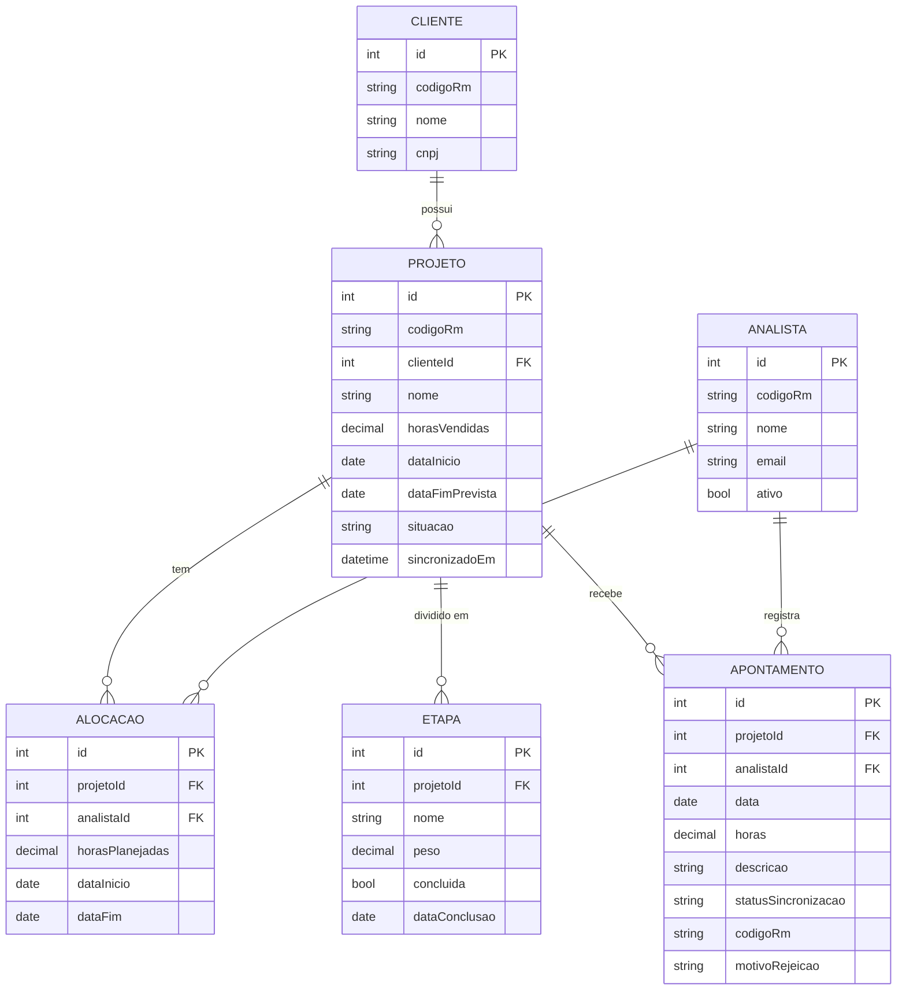
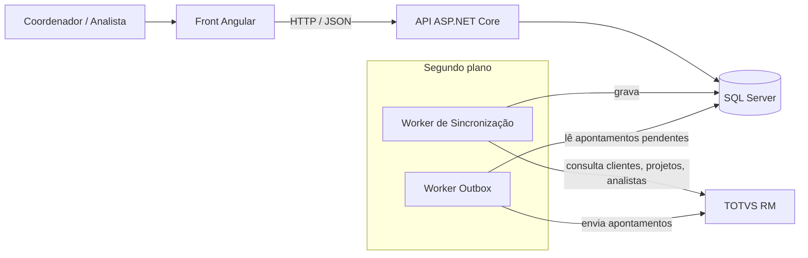

# Painel de Projetos — Documento de Design

## 0. Introdução

A coordenação da PVT precisa acompanhar a saúde dos projetos: para cada projeto, quanto foi vendido, planejado e realizado, qual o saldo de horas e quais projetos estão críticos.

Este documento descreve o desenho técnico do módulo "Painel de Projetos": a modelagem dos dados, a arquitetura, a API, as regras de negócio, as decisões tomadas e como a solução evoluiria com mais escala.

O TOTVS RM é tratado como um sistema externo (caixa preta) e seus dados são simulados.

---

## 1. Modelagem do domínio

### 1.1 Entidades

| Entidade | Principais atributos | O que representa |
|---|---|---|
| **Cliente** | id, codigoRm, nome, cnpj | Empresa contratante |
| **Projeto** | id, codigoRm, clienteId, nome, horasVendidas, dataInicio, dataFimPrevista, situacao, sincronizadoEm | O projeto vendido ao cliente |
| **Analista** | id, codigoRm, nome, email, ativo | Profissional da PVT |
| **Alocacao** | id, projetoId, analistaId, horasPlanejadas, dataInicio, dataFim | Quantas horas um analista tem planejadas em um projeto |
| **Etapa** | id, projetoId, nome, peso, concluida, dataConclusao | Uma parte da entrega do projeto, usada para medir o avanço físico |
| **Apontamento** | id, projetoId, analistaId, data, horas, descricao, statusSincronizacao, codigoRm, motivoRejeicao | Horas trabalhadas registradas pelo analista |

### 1.2 Relacionamentos

- Um **Cliente** tem vários **Projetos**.
- Um **Projeto** tem várias **Alocações**, **Etapas** e **Apontamentos**.
- Um **Analista** tem várias **Alocações** e **Apontamentos**.
- **Projeto** e **Analista** têm uma relação muitos-para-muitos, resolvida pela **Alocação**, que também guarda as horas planejadas.

### 1.3 Diagrama



### 1.4 Origem dos dados

O RM é a fonte oficial, mas nem todo dado nasce nele. A regra que usei: **o que é contratual e oficial vem do RM; o que é gestão do dia a dia nasce no portal.**

| Entidade | Origem | Motivo |
|---|---|---|
| Cliente | RM | Cadastro comercial oficial |
| Projeto | RM | Nasce do contrato; as horas vendidas são oficiais |
| Analista | RM | Cadastro de pessoal |
| Alocacao | Portal | Planejamento operacional do coordenador |
| Etapa | Portal | Acompanhamento da entrega |
| Apontamento | Portal → RM | Registrado no portal e enviado ao RM |

### 1.5 Pontos importantes da modelagem

- **`codigoRm`** é o identificador do registro no RM. Ele tem três usos:
  - **Na sincronização (RM → portal):** indica se um registro já existe no banco (atualizar) ou é novo (inserir), evitando duplicados.
  - **No envio (portal → RM):** o RM não conhece os ids do portal, então o apontamento é enviado com o `codigoRm` do projeto e do analista.
  - **No apontamento:** começa vazio e é preenchido com o id que o RM devolve ao aceitar o registro. Isso permite rastrear, corrigir ou cancelar o apontamento no RM depois.
- **Planejado, realizado, saldo e status não são colunas.** São calculados a partir dos dados de origem, para estarem sempre consistentes (ver seção 5).
- **O peso da etapa** é um percentual. Os pesos de um projeto somam 100%, e o avanço físico é a soma dos pesos das etapas concluídas.
- **`sincronizadoEm`** registra quando o projeto foi atualizado pela última vez a partir do RM. O painel mostra o horário mais antigo entre os projetos listados, para que "dados atualizados às X" seja verdade para todos.
- **`statusSincronizacao`** do apontamento pode ser `Pendente`, `Sincronizado` ou `Rejeitado` (ver seção 2).

---

## 2. Arquitetura da solução

### 2.1 Visão geral

A regra principal da arquitetura: **nenhuma requisição de usuário fala com o RM.** O painel e a API trabalham sempre com o banco do portal. Só processos em segundo plano (workers) conversam com o RM.



### 2.2 Camadas

**Front (Angular + TypeScript).** Exibe o painel e o formulário de apontamento. Não contém regra de negócio: mostra o que a API devolve. Responsivo, para uso em celular e desktop.

**API (ASP.NET Core Web API)**, dividida em três camadas:

- **Controllers:** recebem a requisição HTTP, validam a entrada e devolvem a resposta.
- **Serviços:** contêm as regras de negócio (saldo, consumo, avanço físico, status).
- **Dados:** acesso ao banco com Entity Framework Core.

A API segue o padrão MVC do ASP.NET Core sem a camada de View: Controllers e Models ficam no .NET, e a View é o Angular. Por isso a API devolve JSON, não HTML. A camada de Serviços existe para que a regra de negócio não fique dentro dos Controllers.

**Banco (SQL Server).** Guarda a cópia sincronizada dos dados do RM e os dados que nascem no portal.

**Workers (`BackgroundService` do .NET).** Processos que rodam em segundo plano, junto com a API:

- **Worker de Sincronização (RM → portal):** periodicamente consulta clientes, projetos e analistas no RM e atualiza o banco, usando o `codigoRm` para decidir entre inserir e atualizar. Registra o `sincronizadoEm`.
- **Worker Outbox (portal → RM):** busca os apontamentos `Pendentes` e envia ao RM, gravando o resultado.

### 2.3 Fluxos

**Leitura (painel)**
1. O front pede a lista de projetos.
2. O serviço busca no banco horas vendidas, apontamentos e etapas, e calcula os indicadores.
3. A API devolve o resultado. O RM não participa.

**Escrita (apontamento)** — padrão Outbox
1. O analista registra o apontamento.
2. A API valida e grava no banco com status `Pendente`. O analista recebe a confirmação na hora.
3. O Worker Outbox envia o apontamento ao RM, com o `codigoRm` do projeto e do analista e o id do portal.
4. Se o RM aceitar, devolve o id do registro criado: gravamos em `codigoRm` e o status vira `Sincronizado`.
5. Se o RM recusar, o status vira `Rejeitado`, com o motivo em `motivoRejeicao`. O analista vê o motivo e corrige registrando um novo apontamento; o rejeitado permanece como histórico.
6. Se o RM não responder, o apontamento continua `Pendente` e é reenviado no próximo ciclo.

O padrão Outbox funciona como a caixa de saída do e-mail: o dado é guardado localmente e enviado quando o destino estiver disponível. Assim o analista nunca fica travado pelo RM, e o RM continua sendo a fonte oficial, porque só horas sincronizadas contam como realizadas.

**Sincronização**
1. A cada intervalo configurável, o Worker de Sincronização consulta o RM.
2. Os dados são traduzidos para o modelo do portal e gravados no banco.

### 2.4 Integração com o RM

O sistema não chama o RM diretamente. Ele depende de uma interface, `IRmClient`, que define o que o portal precisa do RM:

```csharp
public interface IRmClient
{
    Task<IEnumerable<ClienteRm>> ObterClientesAsync();
    Task<IEnumerable<ProjetoRm>> ObterProjetosAsync();
    Task<IEnumerable<AnalistaRm>> ObterAnalistasAsync();
    Task<ResultadoEnvio> EnviarApontamentoAsync(Apontamento apontamento);
}
```

- **`MockRmClient`:** implementação com dados simulados, usada neste projeto.
- **`TotvsRmClient`:** implementação real, a ser feita quando a forma de integração da PVT for conhecida.

Toda a tradução entre os dois sistemas (nomes de campos do RM, ids do portal e códigos do RM, REST ou SOAP) fica dentro da implementação. Trocar o mock pela integração real não altera serviços nem workers.

---

## 3. Design da API

### 3.1 Princípios

- **Dados vindos do RM são somente leitura.** Não há endpoints para criar ou alterar clientes, projetos ou analistas, para não existirem duas fontes da verdade.
- **A API devolve os indicadores já calculados.** O front só exibe.
- **Convenção REST:** a URL representa o recurso (substantivo, no plural) e o verbo HTTP indica a ação.

### 3.2 Endpoints

**Painel**

| Verbo | Rota | Retorno |
|---|---|---|
| GET | `/api/projetos` | Lista de projetos com vendido, planejado, realizado, saldo, consumo, avanço físico e status. Filtros: `status`, `clienteId`, `situacao` (padrão: só projetos ativos) |
| GET | `/api/projetos/{id}` | Detalhe do projeto: indicadores, alocações e etapas |

**Apontamentos**

| Verbo | Rota | Retorno |
|---|---|---|
| POST | `/api/apontamentos` | Registra um apontamento (nasce `Pendente`) |
| GET | `/api/projetos/{id}/apontamentos` | Apontamentos do projeto, com status de sincronização |

**Gestão do portal**

| Verbo | Rota | Retorno |
|---|---|---|
| POST | `/api/projetos/{id}/alocacoes` | Aloca um analista com horas planejadas |
| POST | `/api/projetos/{id}/etapas` | Cria uma etapa com peso. A soma dos pesos do projeto não pode passar de 100% |
| PATCH | `/api/etapas/{id}` | Marca uma etapa como concluída |

Uso `PATCH` para concluir etapa porque só o campo `concluida` muda. Com `PUT`, seria preciso enviar a etapa inteira, com risco de sobrescrever outros campos.

### 3.3 Exemplo: `GET /api/projetos`

```json
{
  "sincronizadoEm": "2026-10-10T10:42:00",
  "projetos": [
    {
      "id": 1,
      "nome": "Implantação RM Folha",
      "cliente": "Metalúrgica Serra",
      "horasVendidas": 200,
      "horasPlanejadas": 180,
      "horasRealizadas": 170,
      "saldo": 30,
      "consumo": 85.0,
      "avancoFisico": 60.0,
      "status": "Critico"
    }
  ]
}
```

O `sincronizadoEm` aparece uma vez, fora da lista, porque vale para o conjunto: é o horário mais antigo entre os projetos retornados.

### 3.4 Exemplo: `POST /api/apontamentos`

```json
{
  "projetoId": 1,
  "analistaId": 3,
  "data": "2026-10-09",
  "horas": 2,
  "descricao": "Configuração do módulo de folha"
}
```

**Validações**
- horas maior que 0 e no máximo 24;
- data não pode ser futura;
- projeto precisa estar ativo;
- analista precisa estar alocado no projeto.

**Respostas**
- `201 Created`: apontamento registrado, com status `Pendente`;
- `400 Bad Request`: falha de validação, com a mensagem do erro; nada é gravado;
- `404 Not Found`: projeto ou analista inexistente.

---

## 4. Regras de negócio

### 4.1 Os três números

- **Vendido:** horas contratadas pelo cliente (`Projeto.horasVendidas`, vindo do RM).
- **Planejado:** soma das horas planejadas nas alocações do projeto.
- **Realizado:** soma das horas dos apontamentos **sincronizados**. Apontamentos pendentes ou rejeitados não contam, para que o número bata com o RM.

### 4.2 Indicadores

| Indicador | Fórmula | O que responde |
|---|---|---|
| Saldo | `vendido − realizado` | Quantas horas ainda restam |
| Consumo | `realizado ÷ vendido × 100` | Quanto do orçamento de horas já foi gasto |
| Avanço físico | soma dos pesos das etapas concluídas | Quanto do trabalho já foi entregue |
| Desvio | `consumo − avanço físico` | Se o gasto está à frente da entrega |

O consumo mede **gasto**, não avanço: gastar 50% das horas não significa ter entregue 50% do projeto. Por isso uso duas medidas separadas, e a comparação entre elas é o que revela uma entrega física atrasada em relação ao financeiro.

Um desvio negativo significa que a entrega está à frente do gasto, o que é saudável.

**Exemplo de avanço físico:** Levantamento (20%), Desenvolvimento (50%) e Testes (30%). Com as duas primeiras concluídas, o avanço físico é 70%.

### 4.3 Classificação de status

As regras são avaliadas e **vale o pior status encontrado**:

| Status | Condição |
|---|---|
| **Crítico** | consumo ≥ 100% **ou** desvio ≥ 20 pontos |
| **Atenção** | consumo ≥ 80% **ou** desvio ≥ 10 pontos |
| **Saudável** | nenhuma das anteriores |

Um projeto é crítico em duas situações, as mesmas citadas pela coordenação:
1. **Estourou as horas:** já consumiu tudo o que foi vendido.
2. **Entrega atrasada em relação ao financeiro:** o gasto está muito à frente da entrega.

Uso "o pior vence" em vez de uma média porque a média esconderia problemas: um consumo baixo poderia diluir um desvio alto.

Os limites (80%, 100%, 10 e 20 pontos) são sugestões iniciais e ficam **configuráveis**, porque são decisões de negócio, não de código.

### 4.4 Exemplos

| Projeto | Vendido | Realizado | Saldo | Consumo | Avanço físico | Desvio | Status |
|---|---|---|---|---|---|---|---|
| A | 200 | 60 | 140 | 30% | 30% | 0 | Saudável |
| B | 200 | 165 | 35 | 82,5% | 80% | 2,5 | Atenção (consumo) |
| C | 200 | 210 | −10 | 105% | 90% | 15 | Crítico (consumo) |
| D | 200 | 170 | 30 | 85% | 60% | 25 | Crítico (desvio) |

O projeto D mostra por que o saldo sozinho não basta: ainda tem 30h, mas entregou só 60% tendo gasto 85%. No ritmo atual, as horas restantes não cobrem o que falta.

### 4.5 Casos de borda

- **Projeto sem horas vendidas:** o consumo não é calculado (evita divisão por zero) e o projeto é classificado como **Atenção**, porque indica um cadastro incompleto.
- **Projeto sem etapas cadastradas:** o avanço físico retorna nulo e a regra de desvio não é aplicada; o status considera apenas o consumo. Sem isso, todo projeto sem etapas pareceria crítico.

---

## 5. Decisões e trade-offs

### 5.1 Stack

| Camada | Escolha | Por quê |
|---|---|---|
| Front | Angular + TypeScript | Alinhado ao ambiente da PVT e à minha experiência |
| Back | ASP.NET Core (.NET/C#) | Alinhado ao ambiente da PVT; `BackgroundService` atende os workers sem ferramentas extras |
| Banco | SQL Server | Relacional, combina naturalmente com .NET e é comum em ambientes TOTVS RM |
| Infra | Docker | Permite subir o SQL Server e a aplicação em qualquer máquina, sem instalação manual |

### 5.2 Modelagem

| Escolhi | Descartei | Por quê | Custo aceito |
|---|---|---|---|
| Alocação como entidade | Horas planejadas como número no Projeto | Relação muitos-para-muitos; sei quem vai fazer o quê | Uma tabela a mais |
| Avanço físico por etapas com peso | Percentual digitado pelo coordenador | O avanço vem de entregas concretas, não de opinião | O coordenador precisa cadastrar etapas |
| Peso da etapa em % | Horas estimadas por etapa | Mais simples; evita outra estimativa para manter coerente | Menos detalhe |
| Apontamento ligado a Projeto e Analista | Apontamento ligado à Alocação | Mais simples e natural | Validar a alocação na regra de negócio |
| Indicadores calculados | Indicadores guardados em colunas | Sempre consistentes com os dados de origem | Performance (tratada na seção 6) |

### 5.3 Arquitetura

| Escolhi | Descartei | Por quê | Custo aceito |
|---|---|---|---|
| Painel lê do banco local | Consultar o RM a cada acesso | Performance e disponibilidade | Dados alguns minutos defasados |
| Apontamento via Outbox | Gravar direto no RM | O analista não trava se o RM estiver lento ou fora | Período como Pendente; tratar rejeições |
| Sincronização periódica | RM avisar o portal sobre mudanças | Funciona sem depender de um recurso do RM | Defasagem do intervalo |
| Monolito com workers | Microsserviços | Um módulo, time pequeno, um deploy | Escala tudo junto |
| Camadas simples e `IRmClient` | Clean Architecture completa | Organização suficiente; mock trocável pela integração real | Menos isolamento formal |

### 5.4 API e regras

| Escolhi | Descartei | Por quê |
|---|---|---|
| Dados do RM somente leitura | CRUD completo | Evita duas fontes da verdade |
| Indicadores calculados na API | Cálculo no front | Regra em um lugar só, fácil de testar e reaproveitar |
| Realizado com apontamentos sincronizados | Incluir pendentes | O número bate com o RM |
| "Pior status vence" | Média ou pontuação | Nenhum problema fica escondido |
| Limites configuráveis | Limites fixos no código | São decisões de negócio |

### 5.5 Premissas

Como não conheço os processos internos da PVT, declaro o que assumi. Se alguma premissa estiver errada, fica claro o que precisa mudar.

1. Os projetos são vendidos em **horas**.
2. Cliente, projeto e analista vêm do RM; alocação e etapa são gerenciadas no portal.
3. O "financeiro" é medido pelas horas consumidas. Se for medido pelo valor faturado, a fórmula do consumo muda, mas a lógica de comparação se mantém.
4. O RM oferece algum meio de integração (web service, consulta ao banco ou outro) que permita consultar clientes, projetos e analistas e registrar apontamentos, informando se o registro foi aceito ou recusado. O meio específico fica isolado na `IRmClient`.
5. O RM não avisa o portal sobre mudanças; por isso a sincronização é periódica.
6. Os limites de status são sugestões iniciais, a validar com a coordenação.

---

## 6. Como eu evoluiria isso

### 6.1 O que o desenho já resolve

- **RM fora do ar, leitura:** o painel lê do banco local e continua funcionando, mostrando a hora da última atualização.
- **RM fora do ar, escrita:** o Outbox guarda os apontamentos como pendentes e envia quando o RM voltar.
- **Muitos acessos:** nenhuma requisição de usuário chega ao RM, então ele não é sobrecarregado pelo painel.

### 6.2 Performance com escala

Em ordem crescente de complexidade, aplicando cada passo só quando o anterior não bastar:

1. **Calcular no banco:** somas feitas pelo SQL Server (`SUM ... GROUP BY`), com índices em `projetoId` nas tabelas de apontamento, alocação e etapa.
2. **Paginação e filtros** no `GET /api/projetos`.
3. **Cache do painel:** os dados só mudam a cada sincronização, então o resultado pode ser calculado uma vez e reaproveitado por todos os usuários até a próxima, quando o cache é descartado. `IMemoryCache` com uma instância; Redis com várias.
4. **Tabela de resumo:** o worker grava os indicadores prontos ao fim de cada sincronização. Isso não contradiz a decisão de calcular em vez de guardar: o risco de inconsistência vinha de vários pontos atualizando a coluna, e aqui um único processo recalcula tudo de uma vez.

### 6.3 Relatórios pesados vindos do ERP

- **Sincronização incremental:** buscar só o que mudou desde a última sincronização (depende de o RM informar a data de alteração).
- **Busca em lotes**, em vez de um único relatório grande.
- **Cargas completas fora do horário de pico.**

### 6.4 ERP lento ou fora do ar

- **Timeout em toda chamada ao RM:** sem ele, um RM lento prende o worker indefinidamente.
- **Retentativas com espera crescente** (1, 5, 15 minutos...), com limite de tentativas e alerta ao final.
- **Circuit breaker:** após várias falhas seguidas, parar de chamar o RM por um período. No .NET, a biblioteca Polly cobre timeout, retentativa e circuit breaker.
- **Alerta de dados antigos:** se a última sincronização passar de um limite (por exemplo, 1 hora), o painel exibe um aviso destacado.
- **Idempotência no envio:** se o RM gravar um apontamento mas a resposta se perder, o reenvio não pode duplicá-lo. O apontamento é sempre enviado com o mesmo id do portal, para o RM reconhecer a repetição. Se o RM não suportar isso, o worker consulta o RM antes de reenviar.

### 6.5 Infraestrutura

- **Docker:** banco, API e front em containers, para subir o ambiente igual em qualquer máquina.
- **Health check:** `GET /health` informando se a API e o banco respondem e quando foi a última sincronização com o RM.
- **Logs estruturados** de cada sincronização e envio.
- **Escala horizontal:** a API pode rodar em várias instâncias atrás de um balanceador. Como os workers estão dentro da API, eles devem rodar em uma única instância, ou ser separados em um serviço próprio, para não haver sincronizações e envios simultâneos.

### 6.6 Funcionalidades futuras

- **Projeção de estouro:** estimar o total de horas no ritmo atual (`realizado ÷ avanço físico`) e alertar antes de o projeto estourar.
- **Alerta de planejado maior que vendido:** sinaliza, antes de qualquer hora ser gasta, que o plano não cabe no contrato.
- **Motivo do status** na resposta da API (ex.: "Crítico: desvio de 25 pontos").
- **Horas a confirmar:** exibir os apontamentos pendentes separados do realizado.
- **Realizado por analista**, comparado com a alocação de cada um.
- **Apontamento ligado à etapa**, para saber onde as horas estão sendo gastas.
- **Validação do total diário:** impedir que a soma dos apontamentos de um analista em um dia passe de 24h.
- **Autenticação e aprovação** de apontamentos pelo coordenador.

### 6.7 Prioridade

1. Timeout e retentativas nas chamadas ao RM
2. Idempotência no envio de apontamentos
3. Índices e cálculo no banco
4. Cache do painel
5. Demais itens, conforme a necessidade
